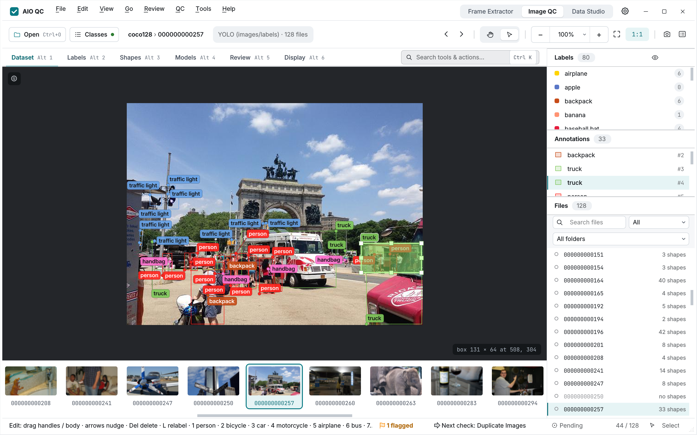
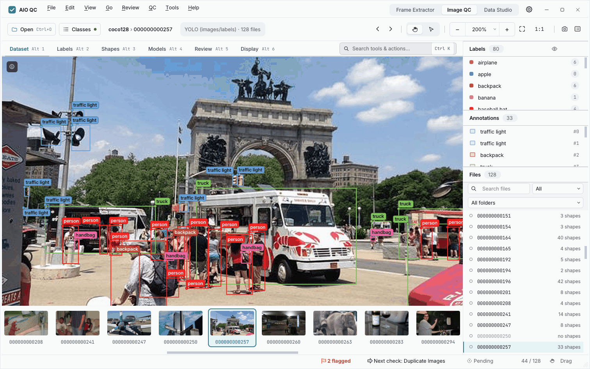
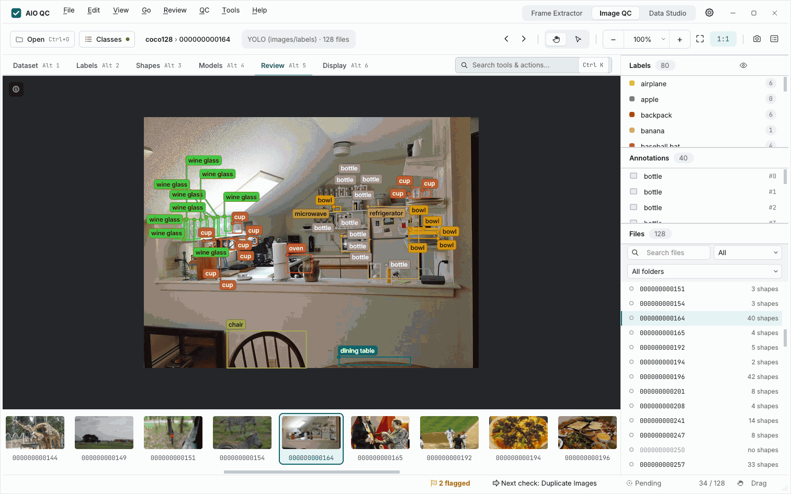
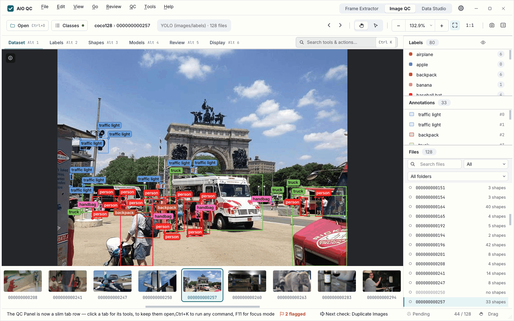
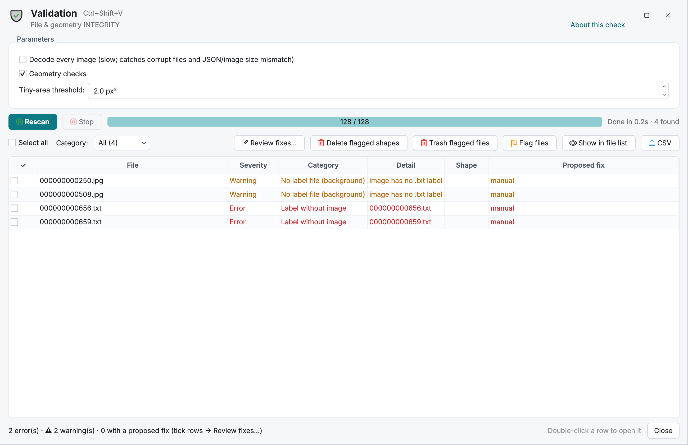
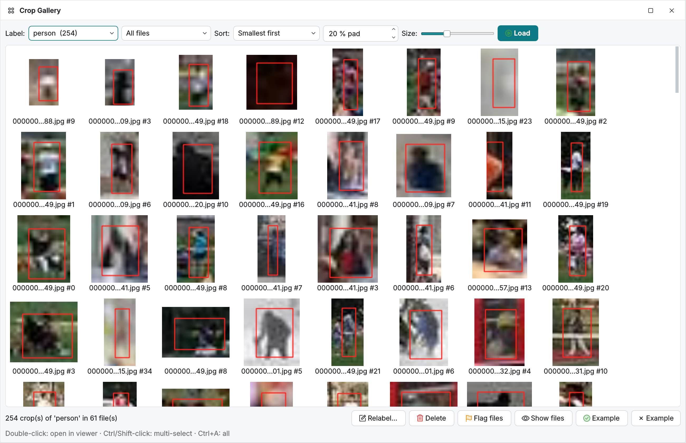
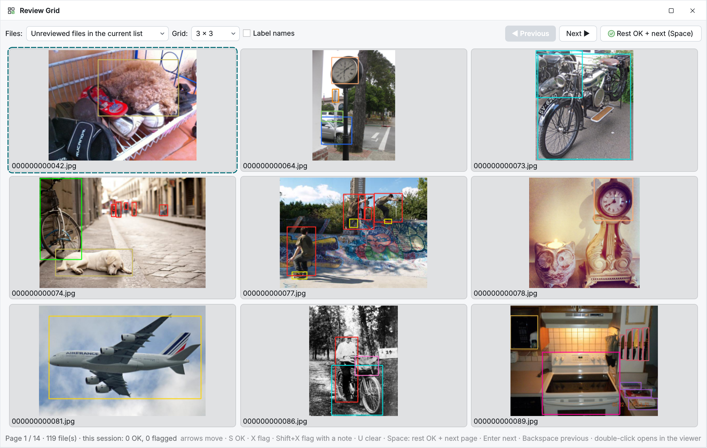
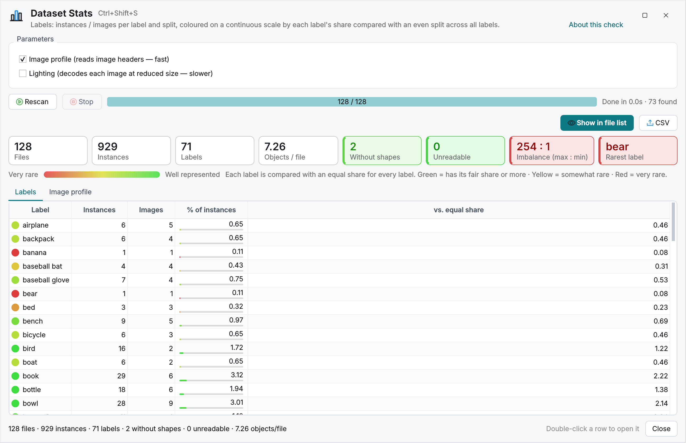
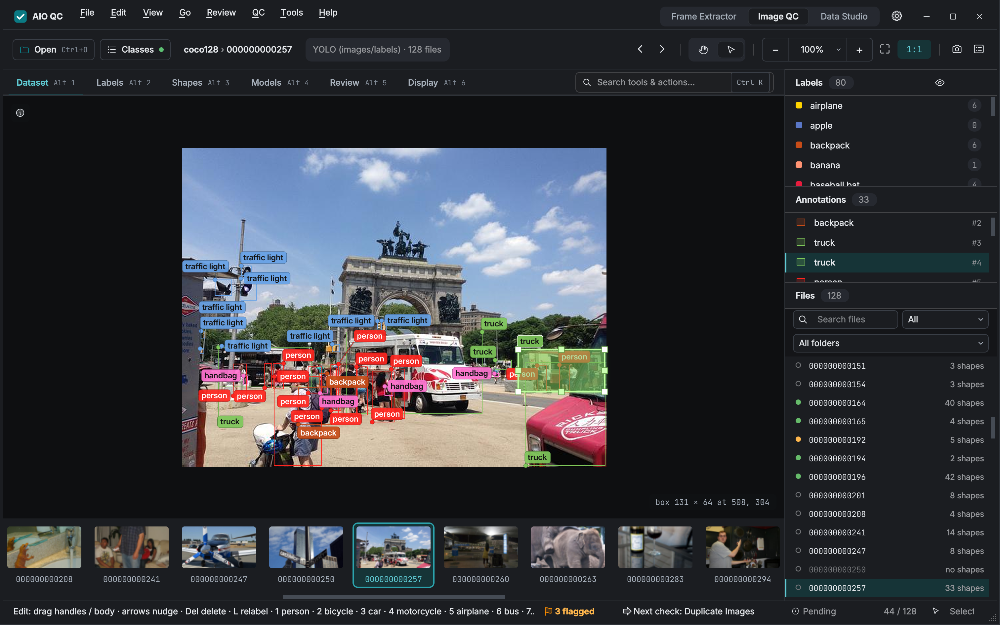

<h1 align="center">
  <table align="center">
    <tr>
      <td></td>
      <td><b>|</b></td>
      <td></td>
    </tr>
  </table>
  <br/>AIO QC
</h1>

<h4 align="center">
  All-in-one quality control for annotated image datasets: LabelMe and YOLO.
</h4>

<div align="center">
  <a href="https://pypi.org/project/aio-qc/"></a>
  <a href="https://pypi.org/project/aio-qc/"></a>
  <a href="https://github.com/3ST4R/aio-qc/blob/main/LICENSE"></a>
  <a href="https://github.com/3ST4R/aio-qc/releases"></a>
</div>

<div align="center">
  <a href="#installation"><b>Installation</b></a>
  | <a href="#usage"><b>Usage</b></a>
  | <a href="#features"><b>Features</b></a>
  | <a href="#keyboard-shortcuts"><b>Shortcuts</b></a>
  | <a href="#faq"><b>FAQ</b></a>
  | <a href="https://github.com/3ST4R/aio-qc/releases"><b>Download ↗</b></a>
</div>

<br/>

<div align="center">
  
</div>

## Description

AIO QC is a desktop app for checking annotated image datasets **before you train**: broken files, wrong or
inconsistent label names, sloppy or duplicate shapes, split leakage and probable mislabels.\
It shows every problem on the image, lets you fix it in the same window, and keeps the original of every file it
changes, so any change can be undone. It is written in Python and uses Qt for its graphical interface.


  \
<i>QC drawer, Review and Zoom</i>

  \
<i>Validation, Crop Gallery and Review Grid.</i>

 \
<i>Stats and Dark appearance</i>

## Features

- [x] LabelMe (v5 and v6, every shape type) and YOLO datasets (detection, segmentation, OBB, pose; flat or split), plus image classification (class folders or LabelMe flags) — the layout is detected automatically
- [x] Ranked checks, worst first, each jumping straight to the problem on the image:
  - **Dataset** — Dataset Stats · Validation · Empty Annotations · Duplicate Images (exact and perceptual, split leakage) · Image Quality · Split Health
  - **Labels** — Label Ambiguities · Label Mapping (view-only renames and merges) · Remove / Re-order Classes · Guidelines
  - **Shapes** — Crop Gallery · Duplicate Shapes · Outliers · Sequence Check (video frames) · Dim / Area · Relationship Rules
  - **Models** — Model Check (report card, confusion, label-error estimate) · OCR Check · Visual Similarity (DINOv3 / SigLIP2 / CLIP), with your models running in their own environment
  - **Review** — Issues Inbox · QC Sampling (error-rate estimate with a verdict) · Review Grid · Saved Views · Coverage Map · Smart Filter · QC Report · Export & Split
- [x] Fix on the image: move, reshape, relabel, delete or draw shapes, with exact undo / redo
- [x] Fix in Editor: hand files to LabelMe or labelImg and get them checked again when they are saved
- [x] Review marks (OK / flag / note) with a next-unreviewed workflow
- [x] Hand-off batches for annotators, merged back with a three-way compare
- [x] Per-class labelling guidelines with good and bad example crops, exportable as one HTML page
- [x] File history: who changed what, when and with which tool — preview any version and revert it
- [x] Data Prep: unzip, combine and flatten, find orphans, integrity check, exact duplicates, resize — each with a preview and undo
- [x] Sketch on the image and ROI capture with real image coordinates
- [x] Export & Split: train / val / test splits that keep duplicates, video frames and OCR identities together, exported as YOLO, LabelMe, COCO or class folders
- [x] Built for big datasets: cached indexing, background work, virtualised lists — fluid at millions of files and shapes
- [x] Safe by design: confirmations, atomic writes, originals kept in a compressed backup store, deletes are moves to a trash folder

## Installation

There are 3 options to install AIO QC:

### Option 1: Using pip

```bash
pip install aio-qc

# with the optional extras (faster JSON, natural sort, YAML, Pillow):
pip install "aio-qc[full]"

# the latest version from GitHub:
# pip install git+https://github.com/3ST4R/aio-qc.git
```

### Option 2: Using standalone executable (easiest)

Download the zip for your system from the [Releases](https://github.com/3ST4R/aio-qc/releases) page — no Python
needed:

- **standalone**: one program file, `AIO-QC.exe` on Windows
- **portable**: one folder that keeps its settings, logs and editor environments inside it (runs from a USB stick and
  leaves nothing on the PC)

### Option 3: From source

```bash
git clone https://github.com/3ST4R/aio-qc.git
cd aio-qc
python -m venv .venv && source .venv/bin/activate      # Windows: .venv\Scripts\activate
pip install -r requirements.txt
python -m AIO_QC
```

### Supported Python and platforms

| | |
| ------ | ------------------------------ |
| Python | 3.10 – 3.13 |
| Qt | Qt6 (PyQt6) |
| OS | Windows / macOS / Linux |
| Required | PyQt6, NumPy, OpenCV, loguru |
| Optional | natsort, Pillow, PyYAML, orjson (picked up automatically) |

Model-based checks (Model Check, OCR Check, Visual Similarity) run your detector, embedding or OCR models in **their own
Python environment** that you choose, so AIO QC itself never needs PyTorch or a GPU.

## Usage

```bash
aio-qc                                # open the app (pip install)
aio-qc-console                        # the same, with the log in a terminal

python -m AIO_QC                      # from source (run from the folder that contains AIO_QC/)
python -m AIO_QC --version            # print the version
python -m AIO_QC --logger-level debug # verbose log in aio_qc_tool.log
```

Click **Open Dir** (`Ctrl+O`) or drop a dataset folder on the window; the layout is detected automatically. On the
first start a short **Get Started** tour shows you around (*Help ▸ Get Started* brings it back), and **`F1`** opens the
user guide.

### Supported datasets

| Layout | Detected when | Notes |
| --- | --- | --- |
| LabelMe | `*.json` anywhere under the folder | v5 and v6, all shape types; sub-folders become filters; `imageData` optional |
| YOLO | `images/` + `labels/` | detection, segmentation, OBB, pose; `data.yaml` / `classes.txt` |
| YOLO split | `<split>/images` + `<split>/labels` | train / val / test, and any split name |
| Classification: class folders | `<class>/<image>`, optionally under splits | changing a class moves the file |
| Classification: LabelMe flags | flags in LabelMe JSONs | multi-label flags supported |

### Keyboard shortcuts

Everything has a key; press **`?`** in the app for the live key map (type to filter, click to run).

| Keys | Action | Keys | Action |
| --- | --- | --- | --- |
| `D` / `A` | next / previous image | `S` / `X` / `U` | mark OK / flag / clear |
| `Ctrl+K` | command palette | `F6` | next panel |
| `Alt+1…6` | open a QC tab | `F11` | focus mode (image only) |
| `Ctrl+0` / `Ctrl+1` | fit / 100 % | double-click | zoom in ↔ back to fit |
| `Ctrl+Z` / `Ctrl+Shift+Z` | undo / redo an edit | `Ctrl+H` | file history |
| `P` / `O` | sketch / ROI capture | `F1` | user guide |

### Your data is safe

- **Nothing changes without a confirmation.** Views, statistics, label mappings and display adjustments never touch files.
- **Atomic writes:** a crash can never leave a half-written annotation, and images are never modified.
- **Originals are kept** in `<dataset>/.aio_qc/backups.sqlite` before every rewrite (compressed, deduplicated) and restored byte for byte.
- **Deletes are moves** into `<dataset>/.aio_qc_trash/`.
- **Changes made by other programs are noticed** and re-read; AIO QC never overwrites them.
- Everything the app stores for a dataset lives in `<dataset>/.aio_qc/` — delete that folder to reset it; your annotations are not in it.

### FAQ

- **Does AIO QC change my annotation files?** Only when you apply a fix, edit on the image, merge a batch or move files, and always after a confirmation. The original is stored first, so every change can be undone.
- **Do I need a GPU or PyTorch?** No. The core app needs neither. Model-based checks run your models in a separate Python environment that you point the app to (the app can create one), using a GPU when there is one.
- **My LabelMe JSONs embed the image (`imageData`). Is that supported?** Yes. Images are read from `imageData` when there is no image file, and *Data Prep ▸ Combine & flatten* can restore the image files.
- **Where are the logs?** `aio_qc_tool.log` in the folder you started the app from (rotated at 10 MB); *Tools ▸ Logs* shows this session's errors. A native crash leaves `aio_qc_crash.log`.

## How to build standalone executable

PyInstaller cannot cross-compile: build on the system you are building for (the
[Build apps](.github/workflows/build-apps.yml) workflow builds Windows, macOS and Linux on every release).

```bash
pip install -r requirements.txt pyinstaller
python packaging/build.py               # both zips for this OS, in dist/
python packaging/build.py --standalone  # one file:   AIO-QC-<version>-<os>-standalone.zip
python packaging/build.py --portable    # one folder: AIO-QC-<version>-<os>-portable.zip
```

## Development

```bash
git clone https://github.com/3ST4R/aio-qc.git
cd aio-qc
pip install -e ".[full]"
python -m AIO_QC --logger-level debug
```

```
AIO_QC/
├── __main__.py        entry point (python -m AIO_QC)
├── app.py             main window; the QC_TOOLS registry builds the tabs, menus and shortcuts
├── core/              Qt-free logic (datasets, checks, backups, history, sampling, data prep …)
├── widgets/           the UI: canvas, panels, tool windows, animations
├── editors/           bundled LabelMe / labelImg sources for Fix in Editor
├── icons/, fonts/     assets
├── help_guide.py      the in-app user guide (F1)
└── CHANGES.md         changelog
```

Issues and pull requests are welcome. Please include the app version, your OS and,
for bugs, the relevant part of `aio_qc_tool.log`. Logic belongs in `core/` (Qt-free, testable); UI in `widgets/`.

## Acknowledgement

- [labelme](https://github.com/wkentaro/labelme) and [labelImg](https://github.com/HumanSignal/labelImg) — bundled
  (modified) as the external editors of *Fix in Editor*.
- [Phosphor Icons](https://phosphoricons.com) — the basis of many of the app's icons.
- [Inter](https://github.com/rsms/inter), [JetBrains Mono](https://github.com/JetBrains/JetBrainsMono),
  [Source Code Pro](https://github.com/adobe-fonts/source-code-pro) and AV Hershey Simplex — the bundled fonts.

## License

AIO QC is released under the [MIT License](LICENSE). Copyright (c) 2026 Preetkaran Singh.

It bundles third-party components that keep their own licenses — notably the **labelme** sources (GPL-3.0), which run
as a separate program for *Fix in Editor*. See [THIRD_PARTY_NOTICES.md](THIRD_PARTY_NOTICES.md); the full license
texts are in [`licenses/`](licenses/).

 \
<i>Stats and Dark appearance</i>
